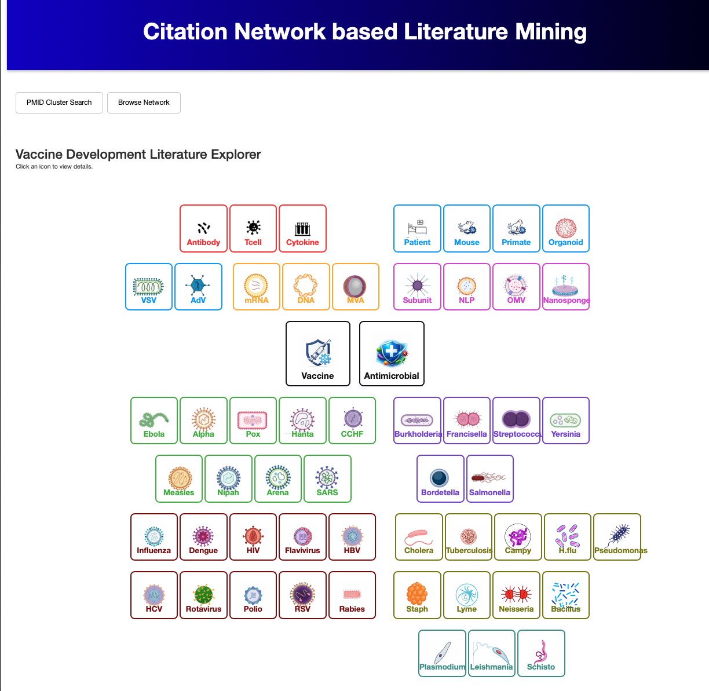
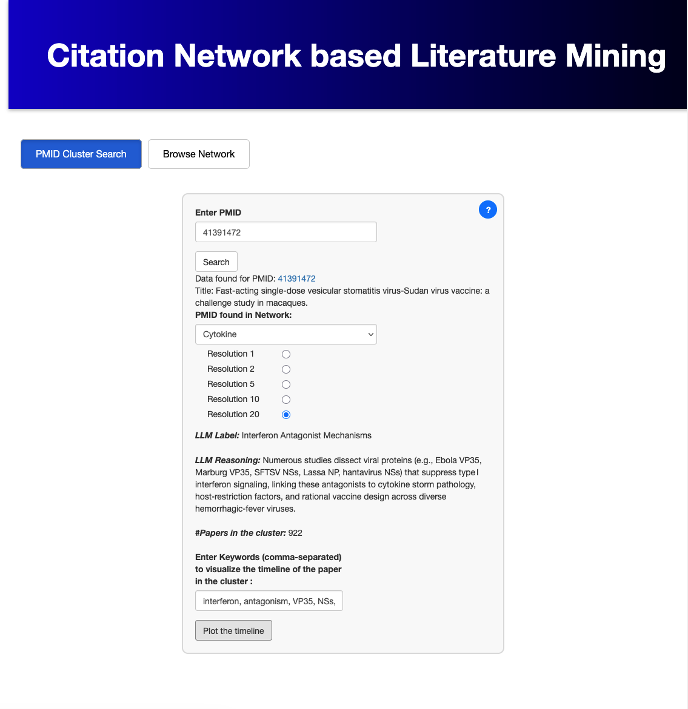
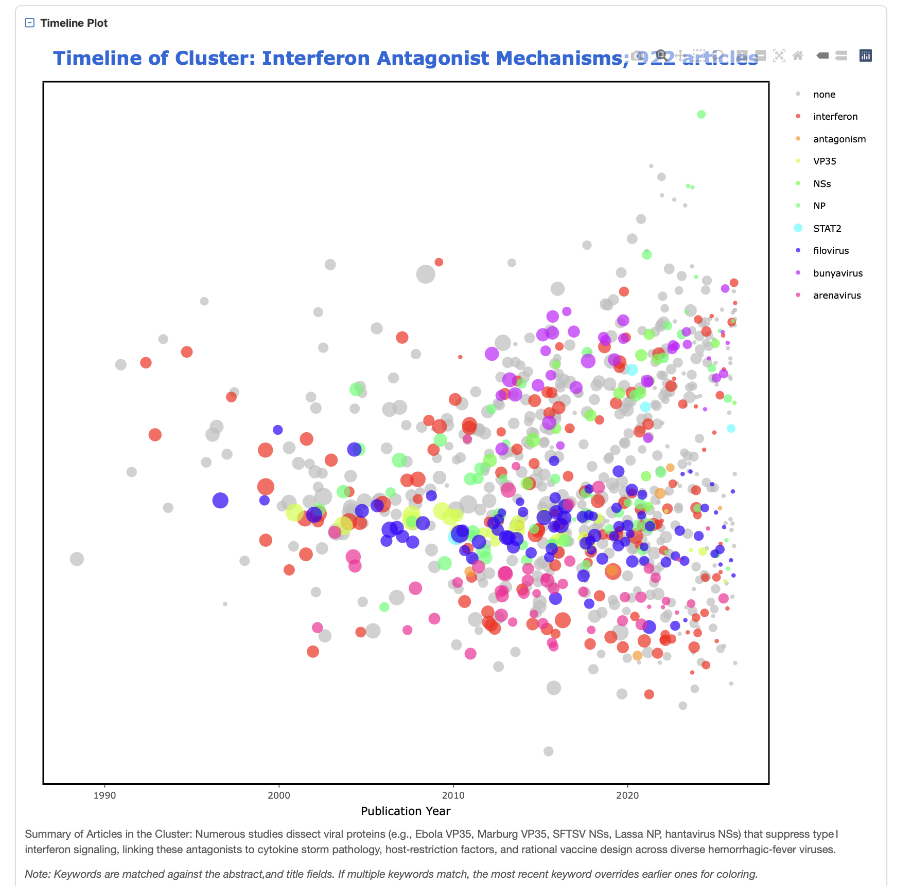
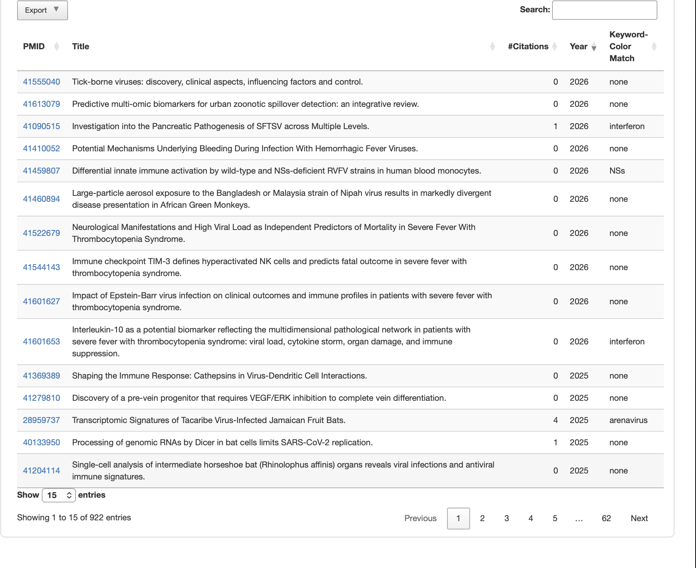
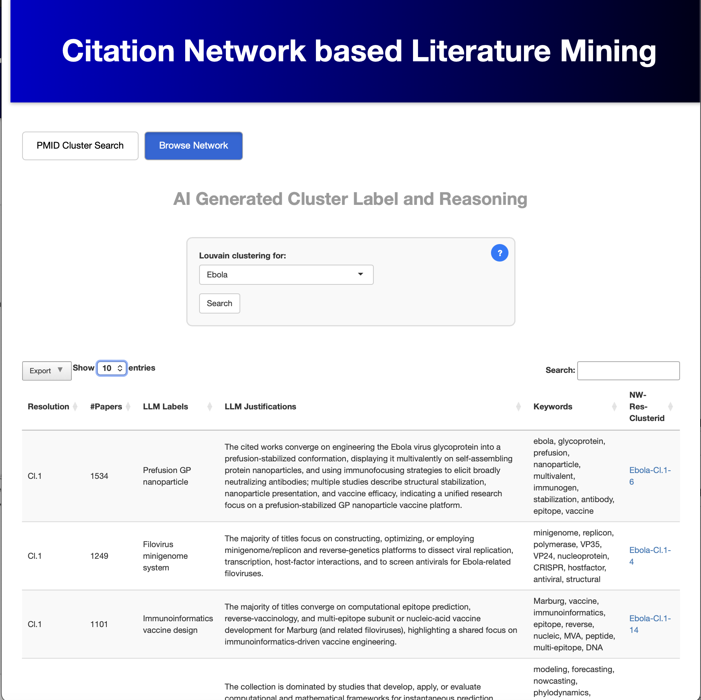
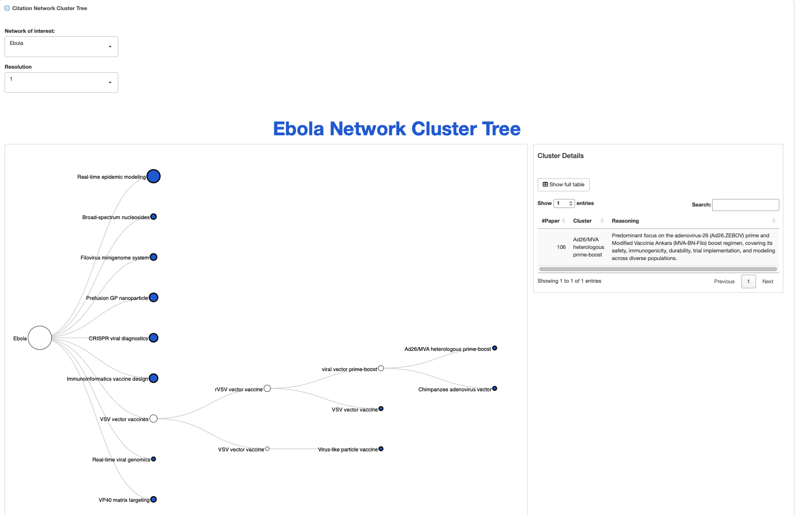
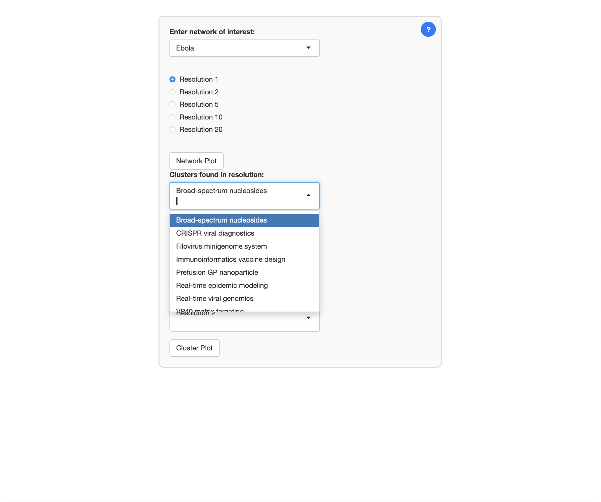
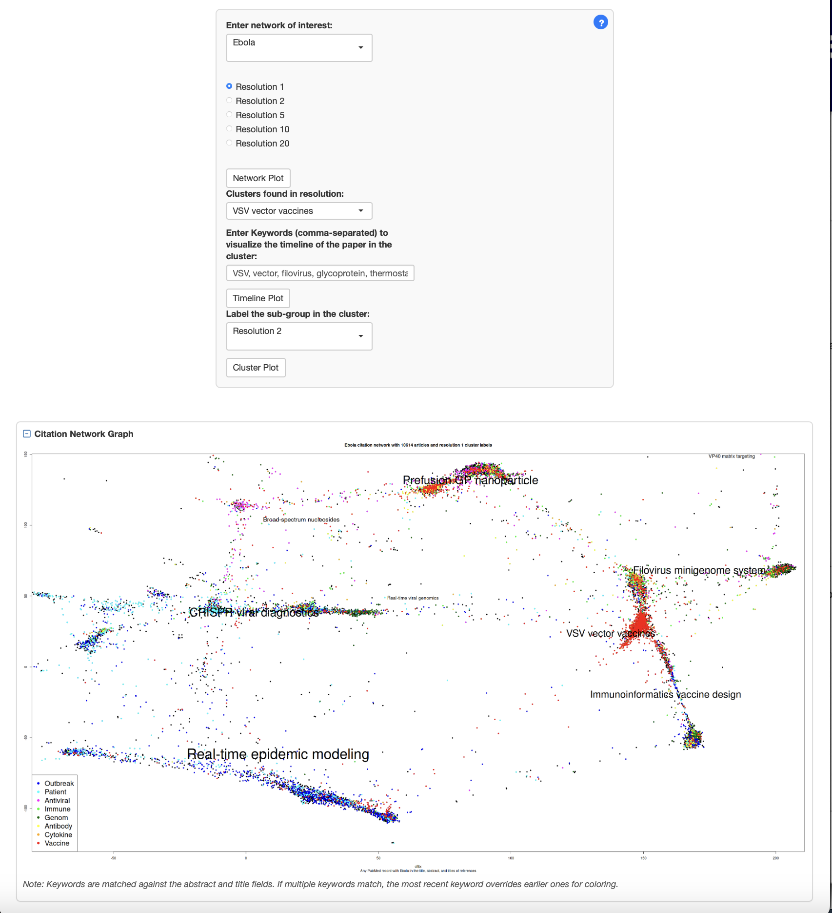
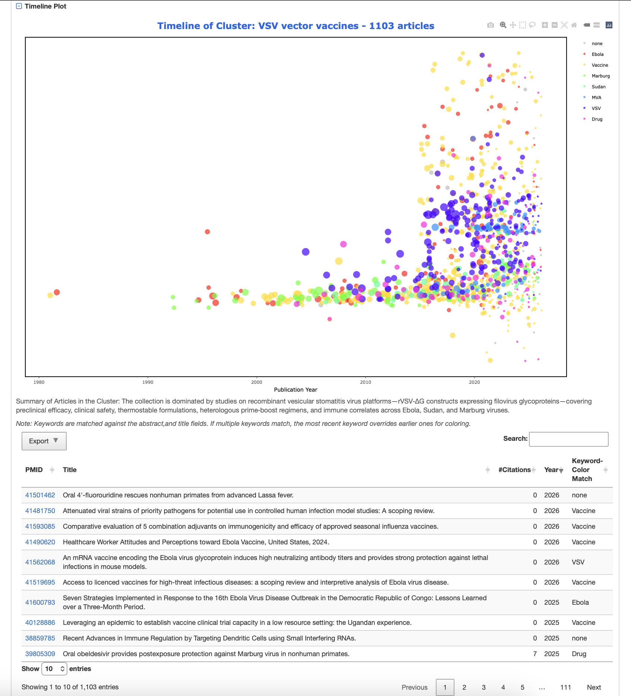

# Vaccine Development Literature Explorer

<!-- Add a concise description and a screenshot/demo link here -->
<p align="center">
  
</p>

<!-- Live demo (optional) -->
<!-- [Live Demo](https://your-shinyapps-link.shinyapps.io) -->

---


## Overview


This project is an interactive **literature organization and exploration application** built on data collected from the **PubMed** database. Literature is initially retrieved using **keyword-based searches** across article abstracts, titles, and referenced titles. Keywords are defined by areas of interest or subject domains; for this application we are focusing on vaccine development research. The area of interest for this topic are *pathogens*,*vaccine platforms*, *host model systems*, *correlates of protection* and *medical countermeasures*. The pathogens are divided into the project pathogens (virus/bacteria), and reference pathogens. 

Relationships between publications and their citations are used to construct a **citation network**, enabling the identification and separation of distinct research areas within a broader subject. This network-based approach allows users to explore how research topics are connected, identify influential works, and observe the evolution of ideas over time.

The primary goal of this tool is to **organize large bodies of literature** and provide an intuitive way to **visualize and explore research landscapes**, helping users understand what has already been done and identify recent innovations within their topic of interest.

The application enables users to:

- Explore and analyze citation-based literature networks

- Interact with dynamic, network-driven visualizations

- Gain insights into research trends, topic clusters, and emerging areas


We have extracted the PubMed literature and generated the citation network for the topics listed below:

**Virus**: *Ebola, Alphavirus, MonkeyPox, Hanta, CCHF, Measles, Nipah, Arenavirus,* and *SARS-CoV-2*

**Bacteria**: *Burkholderia, Francisella, Streptococcus, Yersinia, Bordetella,* and *Salmonella*

**Reference Pathogens[Virus]**: *Influenza, Dengue, HIV, Flavivirus, HBV, HCV, Rotavirus, Polio, RSV,* and Rabies*

**Reference Pathogens[Bacteria]**: *Cholera, Tuberculosis, Campy, H.flu, Pseudomonas, Staphylococcus, Lyme, Neisseria,* and *Bacillus*

**Reference Pathogens[Parasite]**: *Plasmodium, Leishmania,* and *Schisto*

**Vaccine Platforms (VP)**: *VSV, AdV, mRNA, DNA, MVA, Subunit, NLP, OMV,* and *Nanosponge*

**Host Model Systems (HMS)**: *Patient, Mouse, Primate* and *Organoid*

**Correlates of Protection (CoP)**: *Antibody, Cytokine,* and *Tcell*

**Medical Countermeasures (MCM)**: *Antimicrobial* and *Vaccine*


---

## Features

- **PMID Cluster Search:** Integrated PMID search enables direct lookup of publications within clusters, supporting validation, contextualization, and attachment of key references.
- **Browse Network:** Supports exploratory citation-network analysis through LLM-generated cluster labels, network-based topic search (e.g., virus, bacteria, VP, HMS, and CoP), and multi-resolution clustering. This feature enables users to interpret cluster themes, navigate the literature from a network perspective, and examine how higher-resolution clustering reveals finer-grained substructures within broader research areas.


---

## Getting Started


**In a terminal (Bash), run:**

```bash
# Unzip the downloaded archive
unzip cit_nw.zip

# Enter the project directory
cd cit_nw
```


### Running the Application

In **R or RStudio**, run the following commands:

```r
# Set the working directory
setwd("path/to/the/directory")

# Load Shiny
library(shiny)

# Run the application
shiny::runApp()
```
  
---
  
## Project Structure

```text
cit_nw/
├── Dockerfile
├── global.R                       # Global objects and preprocessing
├── Makefile
├── README.md
├── server.R                       # Server logic
├── ui.R                           # UI layout
└── www/
    ├── app_img/                   # Application images
    ├── icons/
    └── new_mdf/                   # Preprocessed citation and network data
    
```
---

## Data Structure


#### `www/new_mdf/x.mdf.RDS`

where x is the subject of interest(eg: ebola, burkholderia, etc.)

- **Format:** RDS
- **Purpose:** Stores preprocessed bibliographic, citation, and network data used by the Shiny application.


| Field | Type | Description |
|------|------|-------------|
| `pmid` | integer | PubMed identifier |
| `title` | character | Publication title |
| `abstract` | character | Publication abstract |
| `year` | character | Year of publication |
| `journal` | character | Publication journal |
| `authors` | character | Publication authors |
| `Nyear` | numeric | Numeric year of publication |
| `Ncits` | integer | Number of citations |
| `Nrefs` | integer | Number of references |
| `x` and `y`  | numeric | Produced by igraph layout(layout_nicely) to visualize the network |
| `full` | logical | Availability of full length article in PubMed database |
| `Cl.1`,`Cl.2`,`Cl.5`,`Cl.10`, and `Cl.20` | numeric | Cluster number generated using Louvain Clustering algo w/resolution 1,2,5,10,20 |
| `x1`,`x2`,`x5`,`x10`,`x20`,`y1`,`y2`,`y5`,`y10`, and `y20` | numeric | x and y produced by louvain clustering per resolution |
| `network` | character | Subject of interest |
| `PoV` | character | Higher level label |
| `labelcl1`,`labelcl2`,`labelcl5`,`labelcl10`,and`labelcl20` | character | PoV-network-Cl.x where x is 1,2,5,10,20 |
| `label1`,`label2`,`label5`,`label10`,and`label20` | character | PoV-network-Cl.x-ClusterNumber where x is 1,2,5,10,20 and ClusterNumber for Cl.x |
| `url` | character | PubMed url|


#### `www/new_mdf/res_img/x.NW.Cly.png`

where x is the network of interest and y is the resolution(1,2,5,10,20)

- **Format:** png
- **Purpose:** Citation Network visualization with Louvain clustering and LLM labels 


#### `www/new_mdf/app_img`

- **Format:** pngs
- **Purpose:** Collection of application screenshots


---


## Prerequisites

-   **R** (version ≥ 4.0.0 recommended)
-   Required R packages (`plotly`, `data.table`, `stringr`, `DT`, `dplyr`, `shiny`, `shinyjs`, `shinyBS`, `htmlwidgets`, `readxl`, `configr`, `shinybusy`, `jsonlite`, `qs2`)

Install missing packages using:

```r
install.packages(c(
  "plotly","data.table","stringr","DT","dplyr","shiny","shinyjs","shinyBS",
  "htmlwidgets","readxl","configr","shinybusy","jsonlite","qs2"
))

```

---


## Usage

### Button: PMID Cluster Search

<p align="center">
  
</p>

<p align="center">
  
</p>

<p align="center">
  
</p>

### Button: Browse Network

<p align="center">
  
</p>

<p align="center">
  
</p>

<p align="center">
  
</p>

<p align="center">
  
</p>

<p align="center">
  
</p>

## <ins>License</ins> 

LANL copyright assertion O5233. This program is released under the MIT License.

## <ins>Copyright Notice</ins>

© 2026. Triad National Security, LLC. All rights reserved.
This program was produced under U.S. Government contract 89233218CNA000001 for Los Alamos
National Laboratory (LANL), which is operated by Triad National Security, LLC for the U.S.
Department of Energy/National Nuclear Security Administration. All rights in the program are
reserved by Triad National Security, LLC, and the U.S. Department of Energy/National Nuclear
Security Administration. The Government is granted for itself and others acting on its behalf a
nonexclusive, paid-up, irrevocable worldwide license in this material to reproduce, prepare
derivative works, distribute copies to the public, perform publicly and display publicly, and to permit
others to do so.


<!--## Installations

git clone https://github.com/<your-username>/<your-repo-name>.git

<!--cd <your-repo-name>--> 


